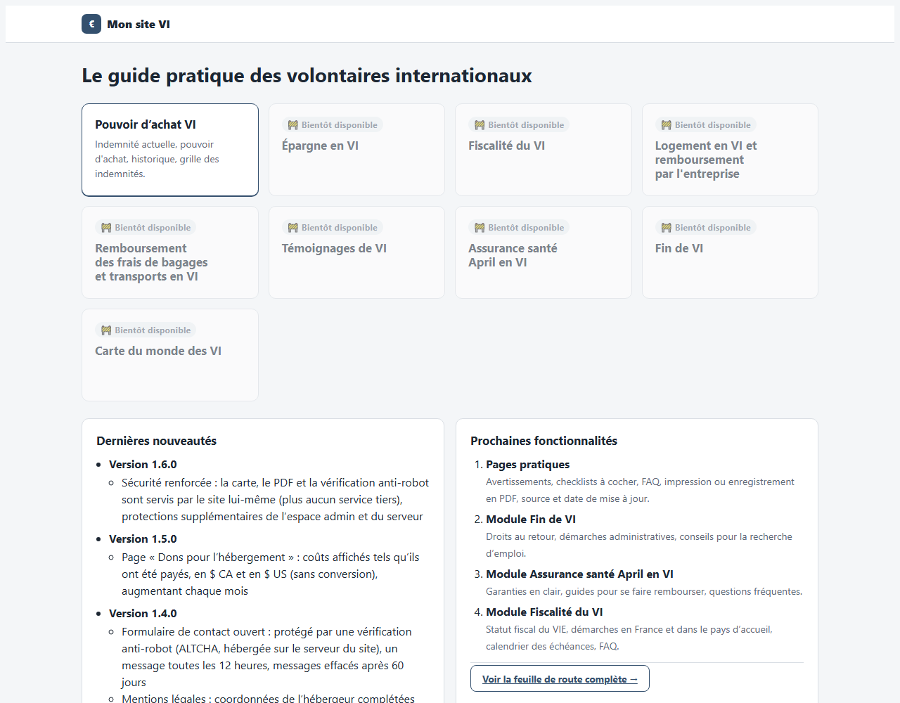
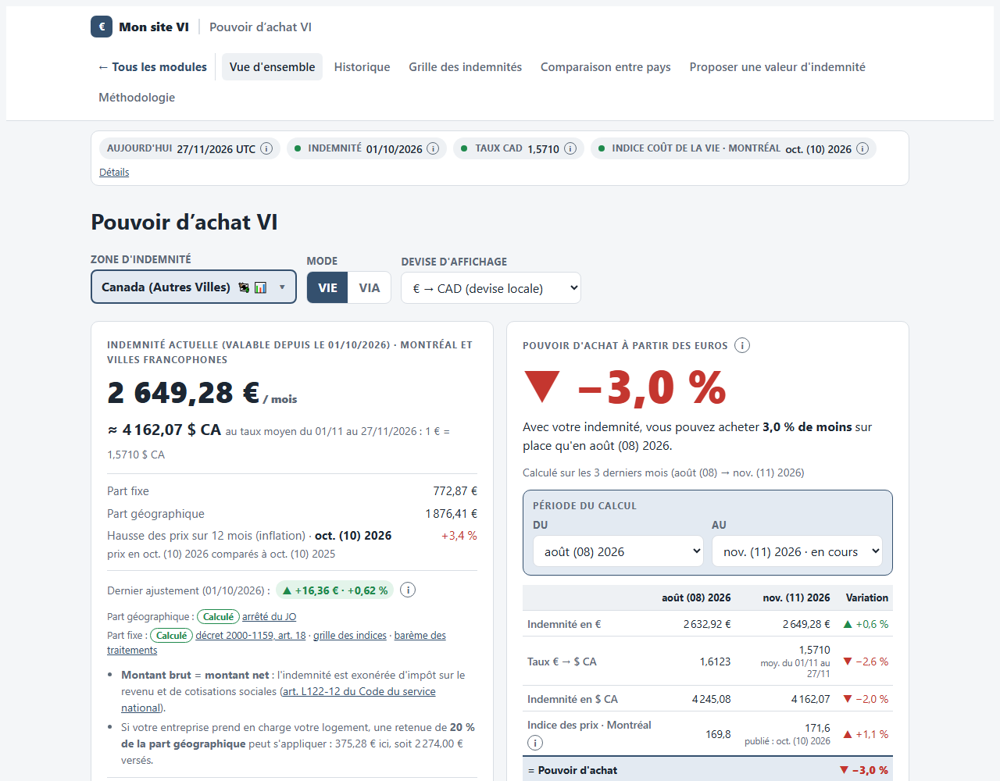
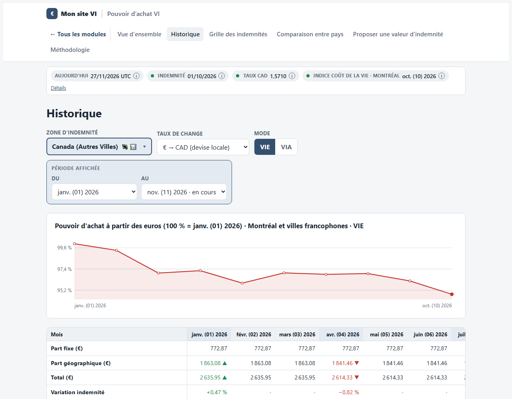
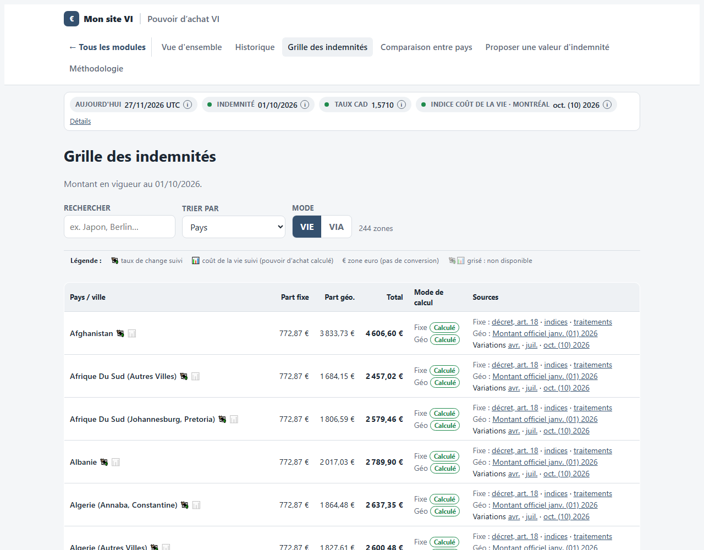
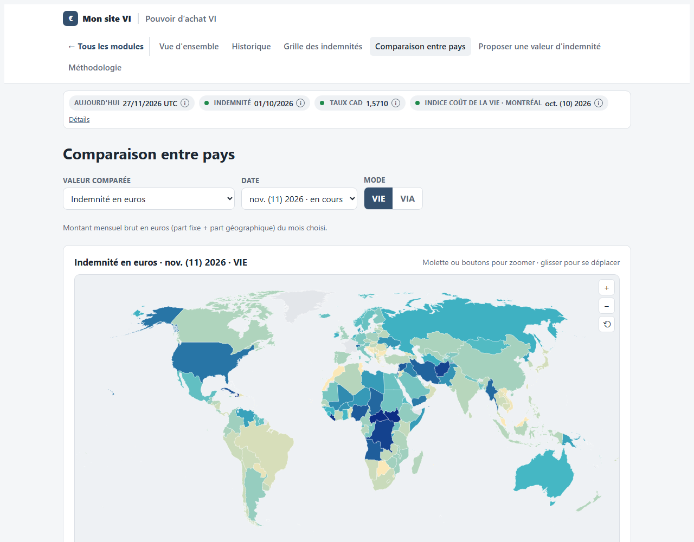
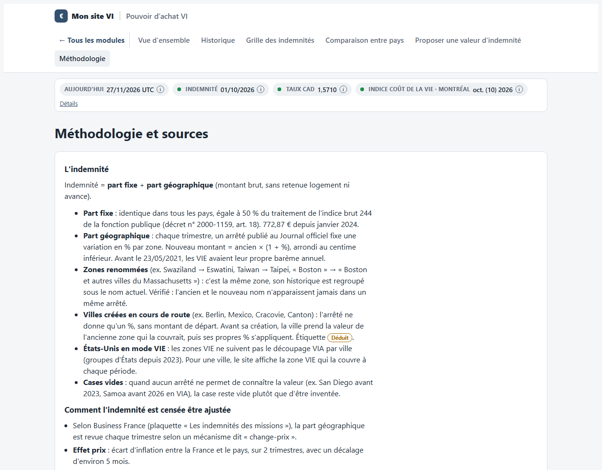

# Site d'information sur l'indemnité des volontaires internationaux (VIE / VIA)

Infos publiques sur les volontaires internationaux (VIE / VIA).

Site public et gratuit qui aide les volontaires internationaux à suivre leur indemnité et leur pouvoir d'achat, à
partir de **données publiques uniquement** (Journal officiel, Légifrance, BCE, Statistique Canada).

- Aucune donnée inventée : une valeur absente reste vide, avec sa raison.
- Aucune donnée personnelle dans ce dépôt (documents et secrets refusés par `.githooks/pre-commit` et par les tests).
- Licence MIT.

## Aperçu

Captures d'une installation de démonstration (réglages neutres : le nom affiché vient de `config-site/site.json`).



**Pouvoir d'achat VI** : indemnité du moment, conversion au taux de la BCE, inflation locale et pouvoir d'achat.



| Historique | Grille des indemnités |
|---|---|
|  |  |

| Comparaison entre pays | Méthodologie |
|---|---|
|  |  |

## 1. Ce qu'il faut installer

### Pour travailler sur le site (ordinateur de développement)

| Outil | Version | À quoi ça sert | Installation (Windows) |
|---|---|---|---|
| **Node.js** | 24 ou plus (testé avec 26 LTS) | faire tourner le site, les tests et la collecte | `winget install OpenJS.NodeJS.LTS` — ou https://nodejs.org |
| **npm** | fourni avec Node.js | installer les dépendances | — |
| **Git** | 2.40 ou plus | récupérer et envoyer le code | `winget install Git.Git` — ou https://git-scm.com |
| **GitHub CLI** (`gh`) | facultatif | créer des versions, suivre les tests | `winget install GitHub.cli` |

**Pas besoin de Docker ni de PostgreSQL** sur l'ordinateur : en local, le site utilise une base PostgreSQL intégrée
(PGlite), créée automatiquement dans `.data/`. **Umami (statistiques de visite) n'est pas inclus en local** : le site
local ne compte aucune visite et le module Statistiques de l'espace admin y affiche « indisponible ». Sur macOS ou Linux, installer les mêmes outils avec le gestionnaire
de paquets habituel.

### Pour mettre le site en ligne (serveur)

| Besoin | Détail |
|---|---|
| **Serveur** | VPS Ubuntu **26.04 LTS** ou **24.04 LTS**, 2 cœurs, 4 Go de mémoire, 20 Go de disque minimum |
| **Accès** | connexion SSH par clé, utilisateur avec droits `sudo` |
| **Nom de domaine** | enregistrements DNS A (et AAAA si IPv6) pour le domaine, `www`, `apercu` et `stats` |
| **Statistiques de visite** | **Umami** (open source, version figée), dans un conteneur sur le serveur. **installé par le script d'installation**, qui vous fait choisir votre identifiant et mot de passe Umami (détail : [docs/installation.md](docs/installation.md#statistiques-de-visite-umami)) |
| **Logiciels** | **rien à installer à la main** : le script d'installation installe Docker, le pare-feu, etc. |

Guide pas à pas : [docs/installation.md](docs/installation.md).

### Comptes personnels (chaque personne qui reprend le projet crée les siens)

| Compte | Obligatoire ? | Rôle | Guide |
|---|---|---|---|
| **GitHub** | oui | héberger le code ; les tests automatiques fabriquent les images publiées sur `ghcr.io` | — |
| **API Légifrance (PISTE)** | non (recommandé) | recalcul quotidien de la part fixe ; sans lui, la dernière valeur connue reste utilisée | [docs/configuration-piste.md](docs/configuration-piste.md) |

Les sources BCE, Statistique Canada et Journal officiel (open data DILA) sont publiques et **sans compte**.

---

## 2. Démarrer le site sur son ordinateur

```
git clone https://github.com/<compte>/<dépôt>.git
cd <dépôt>
npm install
```

Puis :

1. **Configuration** : copier `.env.example` en `.env`. En local, seules les lignes de l'espace admin sont utiles :
   - `ADMIN_EMAIL` : email de connexion ;
   - `ADMIN_PASSWORD_HASH` : empreinte du mot de passe, à générer avec
     `node -e "require('@node-rs/argon2').hash('mon mot de passe').then(console.log)"` — dans le fichier `.env`,
     écrire chaque `$` sous la forme `\$` ;
   - `SESSION_SECRET` : une longue suite de caractères au hasard (clé qui signe le cookie de connexion admin et brouille
     les adresses IP du blocage ; sur le serveur, le script d'installation la crée tout seul) ;
   - `PISTE_CLIENT_ID` / `PISTE_CLIENT_SECRET` : facultatifs (voir le guide PISTE) ;
   - `UMAMI_*` : à laisser vides en local (pas d'Umami sur l'ordinateur). Sur le serveur, le script d'installation
     les remplit. Ne pas y recopier les valeurs du serveur : vos tests seraient comptés dans les vraies statistiques.
   - **Réglages du site** (facultatif) : copier `site.exemple.json` en `config-site/site.json` et l'adapter (nom du
     site, hébergeur, lien de dons, coûts d'hébergement). Ce dossier n'est jamais envoyé sur GitHub ; sans lui, le site
     affiche des valeurs neutres.
2. **Données** : `npm run db:seed` charge les données publiques de départ (quelques secondes).
3. **Site** : `npm run dev`, puis ouvrir http://localhost:3000 (espace admin : http://localhost:3000/#admin).

Le fichier `.env` et le dossier `.data/` ne sont jamais envoyés sur GitHub.

## 3. Commandes

### Sur l'ordinateur de développement

| Commande | Effet |
|---|---|
| `npm run dev` | site local avec rechargement automatique |
| `npm run build` | construit la version de production (vérifie qu'il n'y a pas d'erreur) |
| `npm test` | tests automatiques |
| `npm run typecheck` | contrôle des types (TypeScript) |
| `npm run db:seed` | (re)charge les données publiques de départ |
| `npm run collecte` | un passage de collecte : BCE, Statistique Canada, Journal officiel, Légifrance |
| `npm run verifier:piste` | vérifie les identifiants de l'API Légifrance |

### Sur le serveur

À lancer dans une session SSH (`ssh <utilisateur>@<serveur>`). Les commandes qui en ont besoin demandent elles-mêmes les
droits d'administrateur.

| Commande | Effet |
|---|---|
| `site-etat` | état général : version en ligne, conteneurs, tâches programmées, dernières sauvegardes, espace disque |
| `site-version` | version en ligne et versions publiées disponibles |
| `sudo site-version vX.Y.Z` | **installe tout de suite une version publiée sur GitHub** (mise à jour sans attendre la nuit, ou retour à une version précédente) ; sauvegarde avant, retour automatique en cas de problème |
| `site-sauvegarde` | sauvegarde immédiate, déposée dans `~/sauvegardes` pour être téléchargée (voir ci-dessous) |
| `site-visites` | dernières pages vues et réseaux les plus actifs, adresses IP tronquées (`site-visites 100 7` : 100 pages sur 7 jours) |
| `site-mdp-admin` | choisir un nouveau mot de passe pour l'espace admin (en cas d'oubli) |
| `sudo site-debloquer` | lever les blocages de 48 h (après trop d'échecs de connexion à l'espace admin) |

Tâches automatiques, lançables aussi à la main :

| Commande | Effet | Automatiquement |
|---|---|---|
| `sudo /usr/local/lib/mettre-a-jour.sh` | installe la dernière version publiée | chaque nuit, 04 h 17 UTC |
| `sudo /usr/local/lib/sauvegarder.sh` | sauvegarde de la base, gardée sur le serveur (7 copies) | chaque nuit, 03 h 47 UTC |
| `sudo /usr/local/lib/collecte.sh` | collecte des données (BCE, Statistique Canada, Journal officiel, Légifrance), site et aperçu | chaque jour, 16 h 37 UTC |
| `sudo /usr/local/lib/apercu.sh` | met à jour l'aperçu si une version « en préparation » est disponible | toutes les 5 minutes |

### Vérifier les dernières mises à jour

| Commande (sur le serveur) | Ce qu'elle montre |
|---|---|
| `site-version` | version installée sur le vrai site (première ligne) |
| `sudo tail -10 /var/log/indemnite-maj.log` | mises à jour du **vrai site** : « Nouvelle version vX.Y.Z », « Version vX.Y.Z en ligne », « Déjà à jour », ou retour automatique en cas de problème |
| `sudo tail -10 /var/log/indemnite-apercu.log` | mises à jour de l'**aperçu** : une ligne « Aperçu mis à jour » à chaque nouvelle version en préparation |
| `sudo tail -10 /var/log/indemnite-collecte.log` | derniers passages de la collecte des données |
| `sudo tail -10 /var/log/indemnite-sauvegarde.log` | dernières sauvegardes |

Le numéro de version est aussi affiché en bas de chaque page : `vX.Y.Z` sur le vrai site, `vX.Y.Z en préparation · <repère>`
sur l'aperçu.

### Télécharger une sauvegarde sur son ordinateur

Depuis l'ordinateur (PowerShell, Terminal…), deux commandes : la première fait une sauvegarde à l'instant sur le serveur,
la seconde la télécharge dans le dossier choisi.

```
ssh -t <utilisateur>@<serveur> site-sauvegarde
scp "<utilisateur>@<serveur>:sauvegardes/*" <dossier de votre ordinateur>
```

La copie contient la base du site (`site.sql.gz`), les statistiques (`stats.sql.gz`), la configuration du serveur
(`env`, avec ses secrets) et les réglages du site (`site.json`) : à garder en lieu sûr.

### Changer l'adresse du dépôt GitHub (renommage, autre compte ou organisation)

Après avoir renommé le dépôt ou l'organisation sur GitHub (ou déplacé le dépôt), deux réglages du serveur doivent suivre :
`GITHUB_PROPRIETAIRE` (compte ou organisation, **en minuscules** : il donne l'adresse des images `ghcr.io/<compte>/…`)
et `DEPOT` (adresse du code). Sur le serveur, en remplaçant `<compte>` et `<dépôt>` :

```
cd /opt/indemnite
sudo sed -i "s|^GITHUB_PROPRIETAIRE=.*|GITHUB_PROPRIETAIRE='<compte>'|; s|^DEPOT=.*|DEPOT='https://github.com/<compte>/<dépôt>.git'|" .env
sudo git remote set-url origin https://github.com/<compte>/<dépôt>.git
sudo git fetch -q --tags --prune --prune-tags origin
site-version
```

`site-version` doit lister les versions publiées du dépôt. Les images restent publiques après un renommage (vérifier
dans GitHub → l'organisation → **Packages** que `indemnite-site` et `indemnite-outils` sont « Public »).

Sur l'ordinateur de développement : `git remote set-url origin https://github.com/<compte>/<dépôt>.git`.

### Mettre en ligne une nouvelle version sans attendre la nuit

1. Publier la version sur GitHub : onglet **Actions** → « Tests et images » → **Run workflow** (branche `dev`, numéro de
   version facultatif, sinon celui de `package.json`).
2. Sur le serveur : `sudo site-version vX.Y.Z`.

## 4. Organisation du code

| Dossier | Contenu |
|---|---|
| `app/` | le site (Next.js) : page principale, API publique (`/api/data`, `/api/histo`) et API de l'espace admin |
| `public/app.js` | l'interface du site (navigation, graphiques, carte, espace admin) |
| `lib/` | base de données, calculs, contrôles des valeurs, collecte (`lib/collect/`) |
| `scripts/` | chargement des données, collecte, migrations |
| `data/` | données publiques de départ (historique reconstitué à partir du Journal officiel) |
| `deploy/` | installation et mises à jour du serveur, sauvegardes, tâches programmées |
| `docs/` | guides (installation, PISTE) et évaluation de la vie privée |
| `tests/` | tests automatiques |

Technologies : Next.js 16, TypeScript, PostgreSQL 17 (PGlite en local), Drizzle ORM, Docker, Caddy.

## 5. Mises à jour et versions

Deux branches seulement :

| Branche | Rôle | Qui écrit dedans |
|---|---|---|
| `dev` | travail en cours : chaque envoi déclenche les tests, puis met à jour l'**aperçu privé** (`apercu.<domaine>`, toutes les 5 min) | vous (ou Claude), à chaque modification |
| `main` | **version en ligne** : toujours égale à la dernière version publiée `vX.Y.Z` | **personne à la main** : GitHub la met à jour tout seul |

- Chaque jour à 04 h 07 UTC, s'il y a du nouveau sur `dev` et que les tests passent, GitHub **avance `main` jusqu'à
  `dev`**, crée l'étiquette `vX.Y.Z` (nouvelle version : le numéro prévu dans `package.json`, celui des
  nouveautés affichées sur le site, sinon +1 au chiffre du milieu) et publie les images ; le serveur l'installe à 04 h 17 UTC,
  avec retour automatique en cas de problème.
- Pour publier tout de suite au lieu d'attendre la nuit : onglet **Actions** de GitHub → « Tests et images » →
  « Run workflow » (branche `dev`, numéro de version facultatif), puis sur le serveur `sudo site-version vX.Y.Z`.
- Pour revenir à une version précédente : `sudo site-version vX.Y.Z` sur le serveur (`main` n'a pas besoin de bouger).
- Le numéro de version est affiché en bas de chaque page.

## 6. Vie privée

Le site republie des données publiques et recueille très peu de renseignements sur ses visiteurs : voir
[docs/evaluation-vie-privee.md](docs/evaluation-vie-privee.md) (évaluation Loi 25 / LPRPDE / RGPD, à tenir à jour).
